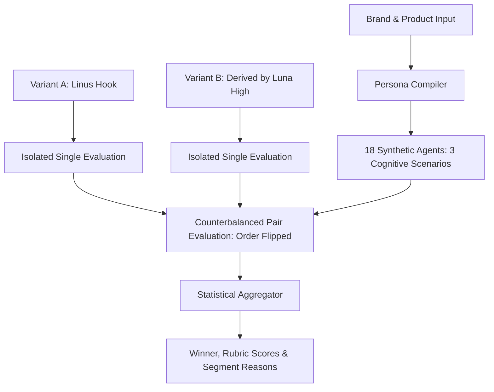

# TestBeforeInvest

> **Open-Source Standalone AI Audience Simulation & Creative A/B Testing Engine**  
> Powered by **Codex CLI (GPT-6 Luna)** and an **Offline Local Evaluator**.

[](https://opensource.org/licenses/MIT)
[](https://www.typescriptlang.org/)
[](https://nodejs.org/)

---

## Overview

**TestBeforeInvest** uses brand and audience inputs to construct a default panel of **18 fictional agents across multiple scenarios** for assessing Instagram stories, ad hooks, and brand copy.

- **Order Checks**: Flips pair presentation order across repeats (**counterbalancing**) to inspect position sensitivity.
- **Two Explicit Engines**: Uses your configured **Codex CLI** (`gpt-6-luna` + `medium/high reasoning`) or offline local rules. This app does not configure an API key or infer CLI billing from a response.
- **Story & Visual Kanca Support**: Test full Instagram Stories, banners, visual descriptions (e.g. *Linus Torvalds meme vs. İlber Ortaylı quote*), or rich HTML.
- **Persona-Level Decision Reasons**: Get generated explanations tied to creative excerpts and criterion scores (*Relevance, Credibility, Clarity, Objection Resolution, Attention, CTA Fit*).

### Research foundation

Our methodological reference is Hut and Masoero's (2026) [Can AI Agents Simulate A/B Test Outcomes? A Validation Framework for Agentic Experimentation](https://www.amazon.science/publications/can-ai-agents-simulate-a-b-test-outcomes-a-validation-framework-for-agentic-experimentation).

The immediate goal is a **working hackathon MVP**. The current engine produces **uncalibrated synthetic panel assessments**. Preference percentages and rubric scores describe this panel; predictive accuracy against real experiments has not yet been measured. Historical validation and pre-period calibration belong to the research roadmap after the MVP.

See [Research foundation](docs/RESEARCH_FOUNDATION.md) for the implementation snapshot and next steps.

---

## Quick Start

### 1. Installation

```bash
git clone https://github.com/hmkarabekir/testbeforeinvest.git
cd testbeforeinvest
npm install
```

### 2. Run the Live Story Demo (CLI)

```bash
npx ts-node src/cli.ts demo
```

You will see the live simulation running:
- **Variant A**: Linus Torvalds meme hook (*"Talk is cheap, show me the code"*)
- **Variant B**: İlber Ortaylı quote hook (*"Cahil kalmayın, mimariyi öğrenin"*)
- Running across 18 isolated developer & intellectual synthetic agents with double-repeat counterbalancing!

### 3. Start the Web UI & API Server

```bash
npm run build
npm start
# or for development:
npm run dev
```

Open your browser at [http://localhost:3344](http://localhost:3344) to interact with the visual dashboard.

Choose **Demo** for up to six identities (one per persona), two repeats, and up to 36 assessments. **Full panel** retains the default 18 identities and 108 assessments. At most two identities run concurrently. Two repeats preserve the presentation-order check; one repeat cannot establish an A/B recommendation under the existing aggregation rules.

### 4. Verify live Luna inference

With the existing CLI installed and authenticated:

```bash
npm run smoke:luna
# Run the complete demo panel:
npm run smoke:luna -- --demo
```

The first command validates separate A, B, and pair assessments using a fixed synthetic fixture. These commands make real model calls; they are excluded from `npm test`. See [the validation record](docs/LUNA_VALIDATION.md) for observed latency and results.

An explicit Codex selection reports provider failures instead of switching to local rules. Invalid responses and transient errors get at most one retry; exhausted assessments remain missing. `AUDIENCE_LAB_TIMEOUT_MS` sets the per-call timeout (default 75000, maximum 120000). Explicit engine selections override `AUDIENCE_LAB_ENGINE`; auto mode respects it.

---

## Architecture: How It Works



### 1. Persona & Identity Synthesis
- Compiles 6 distinct personas based on your category (`personal-brand`, `creator`, `software`, `coffee`, `furniture`).
- Multiplies each persona into **3 distinct cognitive states**:
  1. **Deliberate / High Skepticism**: Reads every detail, demands hard evidence.
  2. **Normal / Medium Skepticism**: Balanced social media scroller.
  3. **Brief / Low Skepticism**: Fast skimmer, hook-sensitive.

### 2. Automated Variant Derivation (`Luna High`)
- You provide Variant A.
- Choose a psychological derivation angle:
  - `authority-hook`: Figures like Linus Torvalds or İlber Ortaylı.
  - `improve-ux`: Simplicity and user experience focus.
  - `contrarian`: Counter-intuitive contrarian hook.
  - `story`: Process & build-in-public journey.
  - `concise`: Short, punchy, direct.
- **GPT-6 Luna with High Reasoning** crafts Variant B without violating underlying product facts.

---

## REST API Reference (For Custom Frontends)

The built-in server exposes standard REST endpoints ready for any React/Vue/Next.js UI:

### `GET /api/health`
Checks engine availability (`codex` or `local-rules`).

### `POST /api/derive-b`
Derives Variant B from Variant A using selected angle.
```json
{
  "dataset": { ... },
  "sourceVariantA": {
    "headline": "...",
    "body": "...",
    "callToAction": "...",
    "format": "story",
    "visualDescription": "Linus Torvalds terminal başında..."
  },
  "angle": "authority-hook"
}
```

### `POST /api/run-experiment`
Executes a counterbalanced simulation; omitted `panelMode` retains the full panel.
```json
{
  "dataset": { ... },
  "variantA": { ... },
  "variantB": { ... },
  "repeats": 2,
  "panelMode": "demo",
  "concurrency": 2,
  "engine": "codex"
}
```

Results include `summary.decision`, the complete `aggregate` diagnostics, `evaluationMode`, synthetic-data `provenance`, `creativeIssues`, and `timing` with per-attempt receipts. Preferences retain missing panel weight. Scores can be `null` when no supported evaluations exist. A returned model identity or billing amount is left unknown when the CLI does not report it.

---

## License

[MIT License](LICENSE) (c) 2026 TestBeforeInvest.
