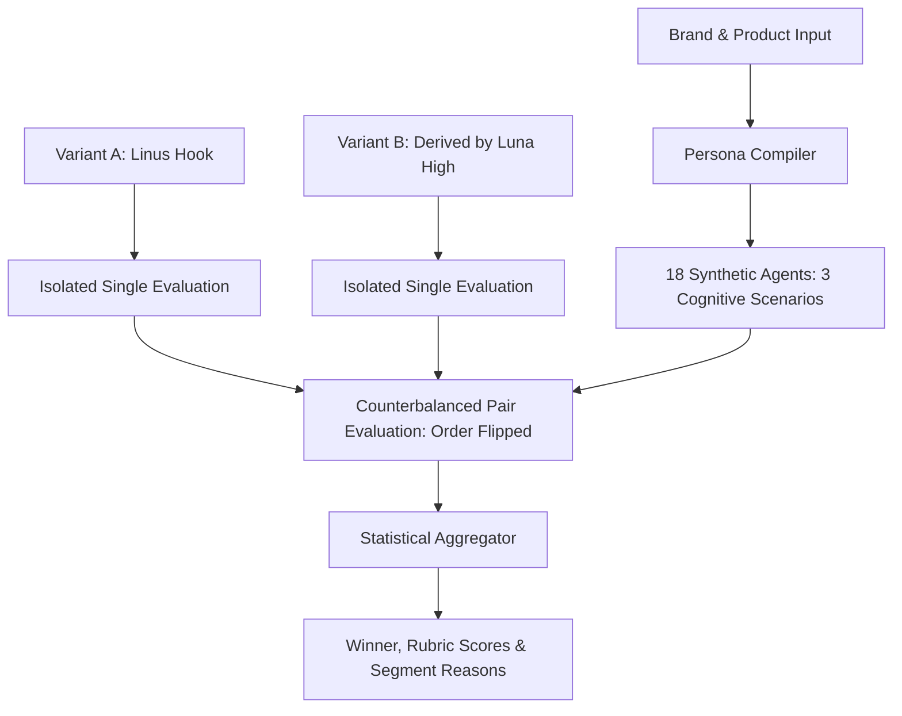

# 🐙 OctopIQ Audience Agent Lab

> **Open-Source Standalone AI Audience Simulation & Creative A/B Testing Engine**  
> Powered by **Codex CLI (GPT-6 Luna · ChatGPT Plus OAuth · 0₺ API Cost)** and **100% Offline Local Evaluator**.

[](https://opensource.org/licenses/MIT)
[](https://www.typescriptlang.org/)
[](https://nodejs.org/)

---

## 🎯 Overview

Instead of publishing blind Instagram stories, ad hooks, or brand copies into the void, **OctopIQ Audience Agent Lab** simulates your real audience using **18 isolated, multi-scenario synthetic agents**.

- **No "A mı B mi?" Guesswork**: Avoids primacy effect / position bias via systematic order-flipping (**counterbalancing**).
- **Zero Cost (0₺ / 0$)**: Runs directly on your local **Codex CLI** (`gpt-6-luna` + `medium/high reasoning`) using your active ChatGPT Plus OAuth session, or completely offline via local rule heuristics.
- **Story & Visual Kanca Support**: Test full Instagram Stories, banners, visual descriptions (e.g. *Linus Torvalds meme vs. İlber Ortaylı quote*), or rich HTML.
- **Segment-Level Decision Reasons**: Get exact qualitative quotes and criterion scores (*Relevance, Credibility, Clarity, Objection Resolution, Attention, CTA Fit*).

---

## 🚀 Quick Start

### 1. Installation

```bash
git clone https://github.com/octopiq/audience-lab.git
cd audience-lab
npm install
```

### 2. Run the Live Story Demo (CLI)

```bash
npx ts-node src/cli.ts demo
```

You will see the live simulation running:
- **Variant A**: Linus Torvalds meme hook (*"Talk is cheap, show me the code"*)
- **Variant B**: İlber Ortaylı quote hook (*"Cahil kalmayın, mimariyi öğrenin"*)
- Running across 18 isolated developer & intellectual synthetic agents with double-repeat counterbalancing!

### 3. Start the Web UI & API Server

```bash
npm start
# or for development:
npm run dev
```

Open your browser at [http://localhost:3344](http://localhost:3344) to interact with the visual dashboard.

---

## 🧠 Architecture: How It Works



### 1. Persona & Identity Synthesis
- Compiles 6 distinct personas based on your category (`personal-brand`, `creator`, `software`, `coffee`, `furniture`).
- Multiplies each persona into **3 distinct cognitive states**:
  1. **Deliberate / High Skepticism**: Reads every detail, demands hard evidence.
  2. **Normal / Medium Skepticism**: Balanced social media scroller.
  3. **Brief / Low Skepticism**: Fast skimmer, hook-sensitive.

### 2. Automated Variant Derivation (`Luna High`)
- You provide Variant A.
- Choose a psychological derivation angle:
  - `authority-hook`: Figures like Linus Torvalds or İlber Ortaylı.
  - `improve-ux`: Simplicity and user experience focus.
  - `contrarian`: Counter-intuitive contrarian hook.
  - `story`: Process & build-in-public journey.
  - `concise`: Short, punchy, direct.
- **GPT-6 Luna with High Reasoning** crafts Variant B without violating underlying product facts.

---

## 🔌 REST API Reference (For Custom Frontends)

The built-in server exposes standard REST endpoints ready for any React/Vue/Next.js UI:

### `GET /api/health`
Checks engine availability (`codex` or `local-rules`).

### `POST /api/derive-b`
Derives Variant B from Variant A using selected angle.
```json
{
  "dataset": { ... },
  "sourceVariantA": {
    "headline": "...",
    "body": "...",
    "callToAction": "...",
    "format": "story",
    "visualDescription": "Linus Torvalds terminal başında..."
  },
  "angle": "authority-hook"
}
```

### `POST /api/run-experiment`
Executes the full 18-agent counterbalanced simulation.
```json
{
  "dataset": { ... },
  "variantA": { ... },
  "variantB": { ... },
  "repeats": 2
}
```

---

## 📜 License

[MIT License](LICENSE) © 2026 OctopIQ & Mert Karabaş.
